# MiniCAD

A compact CAD/CAM application for 2D DXF drafting, exact 3D solid editing and
CNC toolpaths, with a desktop interface and headless CLI. Built with Python,
PyQt6, ezdxf, OpenCascade (OCP) and Cavalier Contours.

**Current version: 0.9.25**

**Project site:** [English](https://maestrofusion360.github.io/minicad-site/) ·
[Русский](https://maestrofusion360.github.io/minicad-site/ru/)

  <a href="assets/images/hero.png">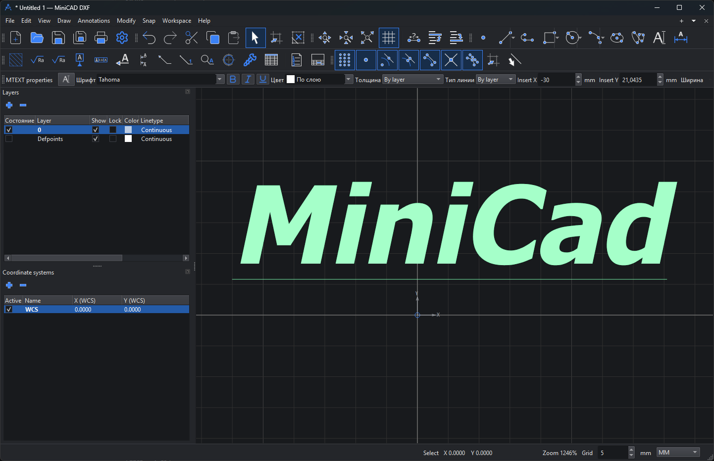</a>

  
<strong>More screenshots</strong>

  
Click a screenshot to view it at full size.

  <table>
    <tr>
      <td align="center" width="50%">
        <a href="assets/images/cad.png">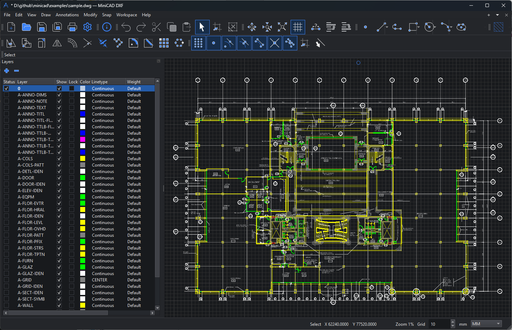</a> 
        2D CAD
      </td>
      <td align="center" width="50%">
        <a href="assets/images/drawing.png">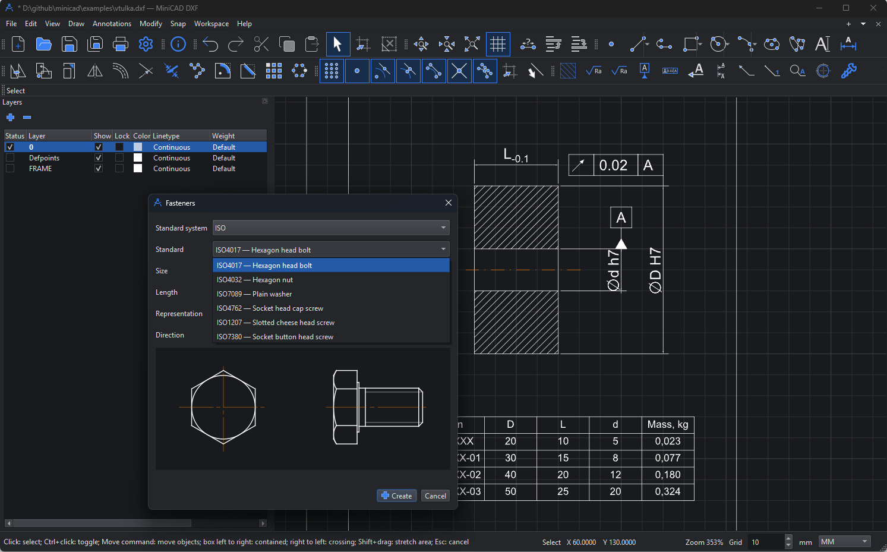</a> 
        Technical drawings
      </td>
    </tr>
    <tr>
      <td align="center" width="50%">
        <a href="assets/images/solid.png">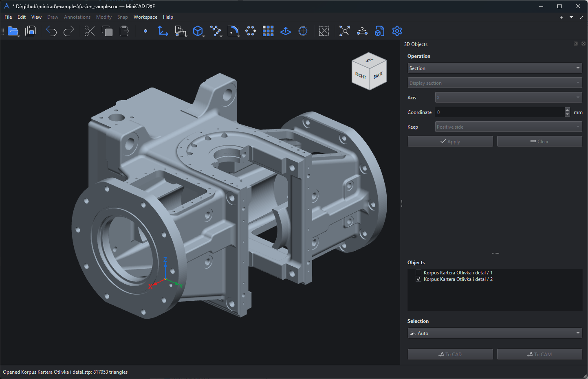</a> 
        3D View
      </td>
      <td align="center" width="50%">
        <a href="assets/images/cam.png">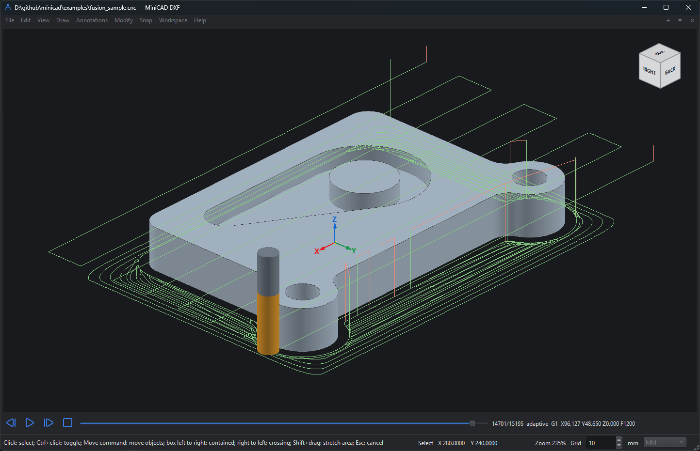</a> 
        CAM tools, NC and playback
      </td>
    </tr>
    <tr>
      <td align="center" width="50%">
        <a href="assets/images/milling.png">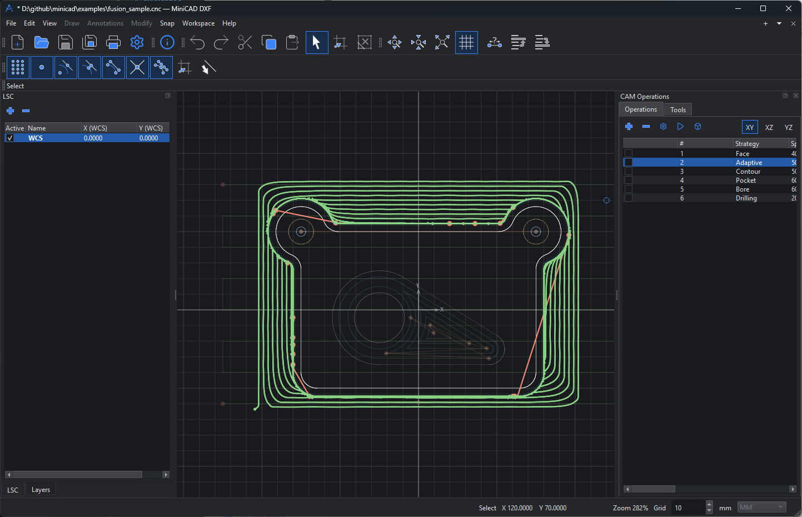</a> 
        Milling CAM
      </td>
      <td align="center" width="50%">
        <a href="assets/images/tool_library.png">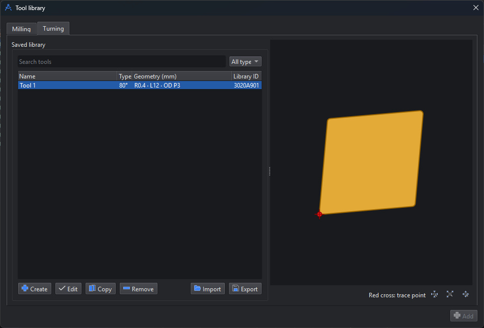</a> 
        Tool library
      </td>
    </tr>
    <tr>
      <td align="center" width="50%">
        <a href="assets/images/turning.png">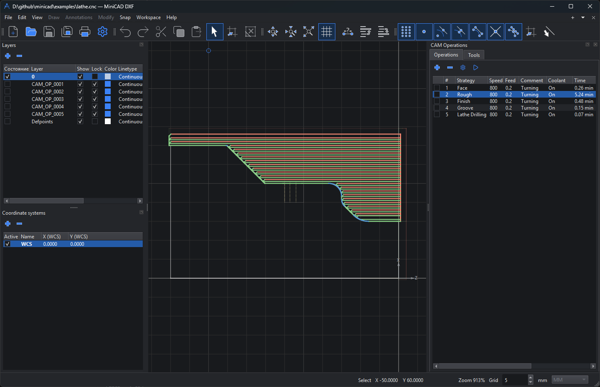</a> 
        Turning CAM
      </td>
      <td align="center" width="50%">
        <a href="assets/images/turning_sim.png">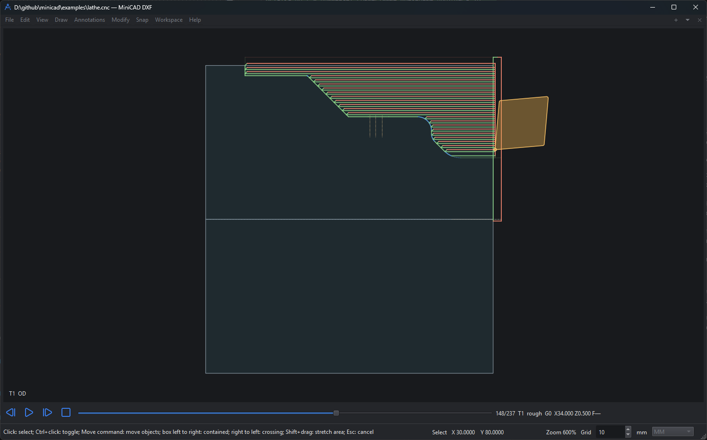</a> 
        Turning simulation
      </td>
    </tr>
    <tr>
      <td align="center" width="50%">
        <a href="assets/images/cutting.png">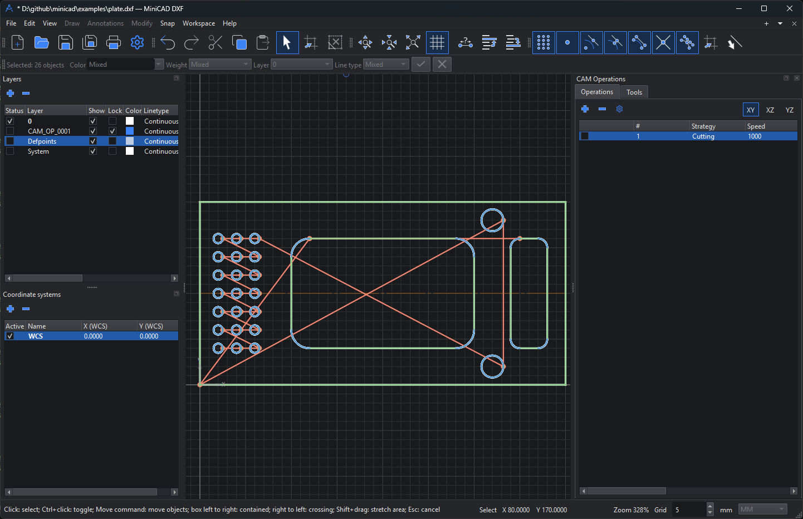</a> 
        Cutting CAM
      </td>
      <td align="center" width="50%">
        <a href="assets/images/cli.png">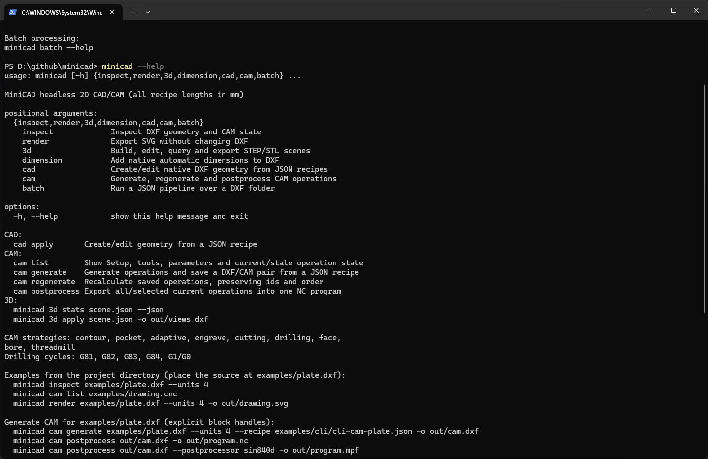</a> 
        Command-line interface
      </td>
    </tr>
  </table>

---

## Features

- **CAD:** geometric construction, numeric input, object/grid snaps and exact
  line/arc offsets; Move, Rotate, Scale, Mirror, Trim, Join, Fillet and Chamfer.
- **Drafting:** dimensions, fits and deviations, hatches, threads, geometric
  tolerances, section/view designations, leaders, tables and title blocks.
  Tables support merged cells, individual row and column sizes, and CSV exchange.
  Catalogue fasteners (ISO 4017, 4032, 7089, 4762, 1207 and 7380) with front/side
  2D views, editable DXF macros and headless generation.
- **Documents:** layers, local coordinate systems, multiple drawings, sheets,
  Undo/Redo and vector printing; native DXF read/write.
- **CLI:** headless DXF inspection, JSON CAD edits, native auto dimensions, SVG,
  CAM generation/regeneration and combined NC, and JSON 3D scene recipes for
  primitives, assemblies, placement, arrays, booleans, fillets/chamfers, geometry
  queries, measurements, sections, body properties, CAM stock and standard views;
  batch pipelines with JSON reports.
- **3D View:** STEP assemblies and STL meshes, seven solid primitives, exact
  booleans, fillets and chamfers; geometric selection filters, edge/face/point
  measurements, placement, arrays, sections, body properties and scene Undo/Redo.
  Full-turn orthographic navigation, ViewCube and exact projections into CAD.
- **CAM:** Setup, Contour, Pocket, Adaptive, Engrave, Cutting,
  Drilling (G81/G82/G83/G84/G1-G0), Face, Bore and ThreadMill; tool-radius offsets,
  depth passes, lead in/out, Toolpath Length and operation copy/paste between
  drawings, with validated Fanuc, Heidenhain ITNC 530 and
  Sinumerik 840D NC output in a separate CAM workspace. Projects are saved in
  `.cnc` archives or as DXF with a per-drawing JSON sidecar; generated XY geometry
  stays in DXF. CAM calculations and NC output use millimetres, regardless of the
  CAD display units: Fanuc uses G21, Sinumerik uses G710 and Heidenhain uses MM.
  Inch output is not supported. Easy G-Code Plot simulation uses an exchange
  bundle with optional stock STL. Milling and turning share a persistent
  tool library with JSON exchange.
- **Turning:** cylindrical Setup, Face, Rough, Finish, Groove, Boring, straight
  Thread Turn (G32) and axial Lathe Drilling with optional pecks,
  exact G18 arcs, insert nose offsets, saved operations and combined ISO G0–G3
  programs through the GUI and CLI.
- **Cutting:** separate zero-offset operation and Setup with AMADA Laser output,
  material/thickness database codes and G92 coordinates. XY geometry/path
  inspection remains available; Play and EGP simulation are disabled for Cutting.

## 3D View

Switch to **3D View** to import STEP/STL or create a Box, Cylinder, Sphere, Cone,
Torus, Prism or Pyramid.

- **Assemblies:** STEP import retains component names, hierarchy paths, placements,
  colours and material metadata. Repeated components share source geometry; each
  instance can be selected, moved or hidden independently.
- **Solid editing:** primitives create independent bodies with named dimensions,
  plane-relative placement and numeric offsets.
  Boolean operations are explicit actions. Planar faces support plain and conventionally
  threaded holes; plane splitting creates separate solids. Two-distance chamfers require an
  explicit reference face. STEP scene export retains assembly metadata.
- **Solid operations:** union, subtraction and intersection; constant-radius fillets
  and symmetric chamfers on selected B-Rep edges or face boundaries. Geometry
  filters select by radius, top/bottom position, axis, surface type or proximity
  and combine or exclude sets. Completed operations retain topology mappings.
- **Measure:** Auto/Points/Edges/Faces filters, exact minimum distances and XYZ
  components, applicable angles, edge length, face area and radius; circular-edge
  pairs also report centre distance. Selected elements are highlighted.
- **Placement and inspection:** move, rotate, mirror, scale, circular/rectangular
  arrays, display sections, body bounds, surface area, volume and material-based
  mass. Middle-drag orbits through full turns, right-drag pans and the wheel zooms.
- **Drawing and CAM:** insert exact orthographic projections into CAD
  or send a body to CAM as a reference triangle mesh. Copy/paste bodies across drawings
  and windows; scene edits have their own Undo/Redo.

Exact solid operations and projections require STEP or native primitives. STL
remains a triangle mesh. Editable 3D scenes are session-based; DXF and CNC
projects do not save the full editable 3D scene.

## Documentation

- [Features and limitations (English)](features.md)
- [Возможности и ограничения (Русский)](features_ru.md)
- [Website development and publishing](DEVELOPMENT.md)

## Availability

This repository contains the standalone MiniCAD website, its public feature
reference and screenshots. The application source code and executable releases
are not included in this repository.

## License

MiniCAD is licensed under GPL-3.0-only. The website sources in this repository are MIT licensed; see [LICENSE](LICENSE).

  

